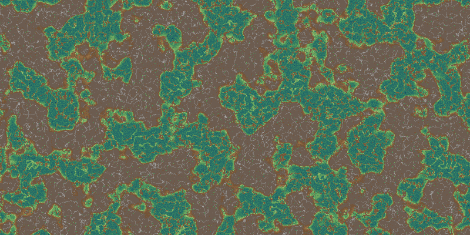
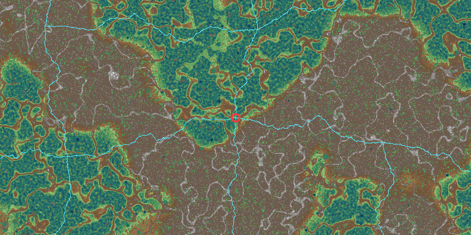
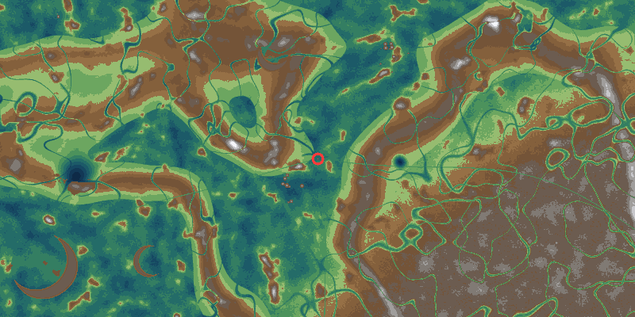
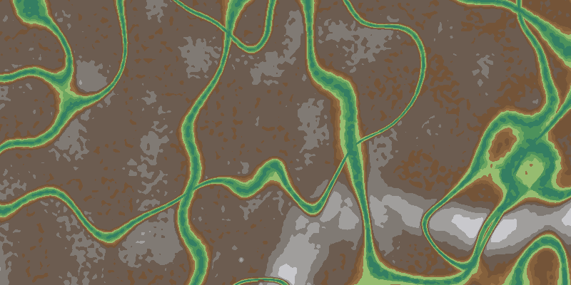
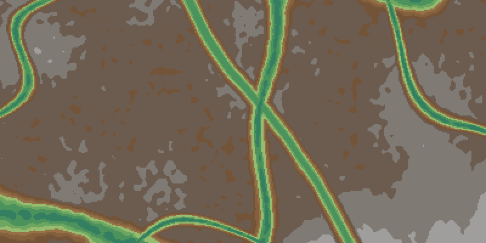
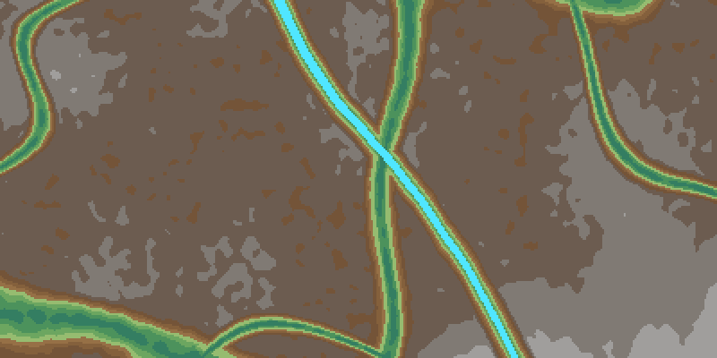
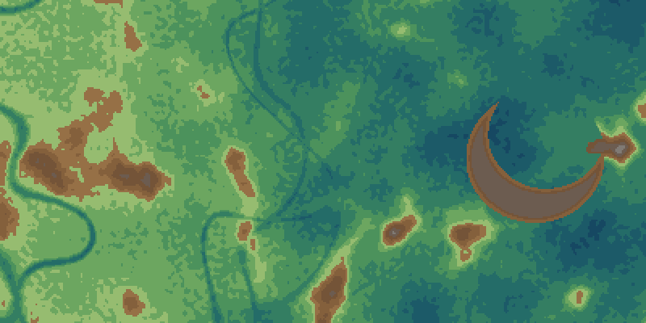
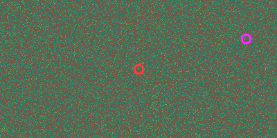
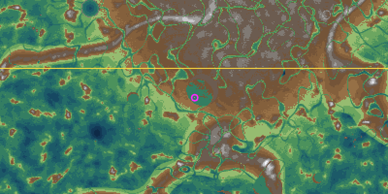

# Day 7 advanced map: generator and viewer

This is a procedural map generator and terminal viewer for a planned "advanced" version of day 7, Buddy's PathFinder. The map is far too big to store or to search naively. It is never stored as data: every tile is computed on demand from one seed.

This folder is a standalone Go module. It is not part of the Astro site build. For how the terrain is built, how the goal works, and how a solver would handle a map this size, see [DESIGN.md](./DESIGN.md).

## The rules the generator guarantees

- `mapgen.Height(seed, x, y)` is a pure function of a `uint64` seed and `int64` coordinates. It never looks at neighbouring tiles, so any tile anywhere in the 2^64 × 2^64 plane can be queried directly. The terrain is equally detailed at `(0, 0)` and at `(2^62, -2^62)`, because large coordinates are never converted to floating point.
- Heights run from **-8 to 8**. A height of **0 or less is passable air**; **1 or more is mountain**. The height only matters for drawing nicer maps.
- **Movement is 4-directional** (north, east, south, west). Two air tiles that touch only at a corner are _not_ connected. There is no diagonal movement and no squeezing between mountains.
- North is `-y`, the top of the screen, as in the original day 7.
- **Every seed is solvable.** The start and the goal are both nodes of a corridor network that is connected by construction, so a route always exists. `Goal(seed)` gives the goal straight away; for an extra-hard run, ignore it and find the goal by exploring with `IsGoal`. See [DESIGN.md](./DESIGN.md#the-goal).
- The same seed always gives the same map. `TestGolden` pins a checksum, so an accidental change to the generator fails the tests.

```go
import "wcf/day07-map/mapgen"

h := mapgen.Height(seed, x, y)     // -8..8
ok := mapgen.Passable(seed, x, y)  // h <= 0
sx, sy := mapgen.Start(seed)       // the corridor node of cell (0, 0)
ok = mapgen.OnCorridor(seed, x, y) // part of the guaranteed-connected network
gx, gy := mapgen.Goal(seed)        // the goal: a corridor node 2^18-2^19 tiles away
ok = mapgen.IsGoal(seed, x, y)     // for the extra-hard version: test tiles as you explore
```

## Running it

You need Go 1.23 or newer. From this folder:

```bash
go run . -seed north-pole
```

If Go isn't installed, the official container works too. Run this from the repository root:

```bash
podman run --rm -it -v "$PWD/tools/day07-map":/src -w /src docker.io/library/golang:1.25 go run . -seed north-pole
```

Commands:

| Command                    | What it does                                                                                                       |
| -------------------------- | ------------------------------------------------------------------------------------------------------------------ |
| `day07-map [view]`         | Interactive viewer (the default)                                                                                   |
| `day07-map dump`           | Prints one frame to stdout. Use `-style shade`, `-style ox` (O/X like day 7) or `-style color`                     |
| `day07-map png -o map.png` | Renders a frame to a PNG (`-w`, `-h`, `-scale`)                                                                    |
| `day07-map goal`           | Prints the start and goal tiles                                                                                    |
| `day07-map stats`          | Passable fraction, height histogram and time per `Height()` call                                                   |
| `day07-map chunk`          | Prints a rectangle of tiles for other programs (`-x`, `-y` top-left, `-w`, `-h`, `-format`); see below             |
| `day07-map serve`          | Answers chunk requests on stdin/stdout so any language can read the map; see below                                 |
| `go test ./...`            | Determinism, golden checksum, far coordinates, terrain and corridor connectivity, the goal and the server protocol |

Every map command takes `-seed` (a number or any string; strings are hashed), `-x` and `-y` (the centre tile; defaults to the start), and `-zoom` (tiles per pixel, a power of two). They also take `-corridors` to highlight the corridor network, and `-palette color|dark|gray|mono` to pick the colours: `color` is the full palette, `dark` draws air in dark greys under coloured mountains, `gray` uses dark greys for air and light greys for mountains with no middle greys, and `mono` is pure black air and white mountains. The viewer starts with that palette, and `png` and `dump -style color` use it too.

### Viewer keys

| Key                                            | Action                                                                                              |
| ---------------------------------------------- | --------------------------------------------------------------------------------------------------- |
| arrows, `w` `a` `s` `d`, `h` `j` `k` `l`       | Pan 4 pixels                                                                                        |
| Shift+arrows, `W` `A` `S` `D`, `H` `J` `K` `L` | Pan half a screen                                                                                   |
| `f`                                            | Toggle fast pan, so the normal pan keys move half a screen                                          |
| `+` / `z`, `-` / `x`                           | Zoom in or out (1 to 2^20 tiles per pixel)                                                          |
| `m`                                            | Switch between colour half blocks and O/X characters                                                |
| `p`                                            | Cycle the palette: color, dark (grey air), gray (dark air, light mountains), mono (black and white) |
| `o` / `0`                                      | Jump to the start                                                                                   |
| `g`                                            | Jump to the goal                                                                                    |
| `c`                                            | Highlight the corridor network                                                                      |
| `?`                                            | Show or hide the help lines                                                                         |
| `q`                                            | Quit                                                                                                |

The status line shows the seed, the centre tile with its height, the zoom, the mode, the goal and the frame time. The default mode draws two square pixels per character cell with `▀` and 24-bit colour, so use a truecolor terminal. Use `m` to switch to O/X characters, drawn in the palette's colours on the terminal's own background. The start is red, the goal is magenta and highlighted corridors are cyan.

When zoomed out, each pixel samples up to 4×4 tiles. A pixel counts as mountain when most samples are mountain, so the passable/impassable split stays honest at every zoom.

## Reading the map from other languages

The generator is a Go package, but a solver can be written in anything. Run `day07-map serve` as a child process, write requests to its stdin one per line, and read the replies from its stdout. Each reply starts with one header line, `ok ...` or `error <message>`, so a client always knows what follows.

| Request                  | Reply                                                               |
| ------------------------ | ------------------------------------------------------------------- |
| `chunk X Y W H [FORMAT]` | `ok W H FORMAT`, then the W×H tiles whose top-left corner is (X, Y) |
| `tile X Y`               | `ok HEIGHT`                                                         |
| `start` / `goal`         | `ok X Y`                                                            |
| `isgoal X Y`             | `ok true` or `ok false`, for the extra-hard version                 |
| `seed`                   | `ok SEED` (the numeric seed)                                        |
| `quit`                   | Exits. So does closing stdin                                        |

Chunk formats (the default is set with `serve -format`, and is `ox` unless you change it):

- `ox`: H lines of W characters, `O` for passable and `X` for mountain, as in the original day 7.
- `heights`: H lines of W heights separated by spaces.
- `raw`: exactly W×H bytes, row by row, each height as a signed byte. This is the fastest to parse.

A chunk can be up to 4096×4096 tiles, computed across all CPUs. A 1024×1024 chunk takes about 0.3 s on 12 cores. Ask for chunks rather than single tiles: `tile` is fine for spot checks, but one request per tile spends far more time on the pipe than on the map.

```python
import subprocess

srv = subprocess.Popen(["./day07-map", "serve", "-seed", "north-pole", "-format", "raw"],
                       stdin=subprocess.PIPE, stdout=subprocess.PIPE)

def ask(line):
    srv.stdin.write((line + "\n").encode())
    srv.stdin.flush()
    head = srv.stdout.readline().decode().split()
    if head[0] != "ok":
        raise RuntimeError(" ".join(head[1:]))
    return head[1:]

sx, sy = map(int, ask("start"))
w, h = 256, 256
ask(f"chunk {sx - w // 2} {sy - h // 2} {w} {h}")
data = srv.stdout.read(w * h)  # row by row
passable = lambda x, y: (data[y * w + x] ^ 0x80) - 0x80 <= 0  # signed byte
```

For a single rectangle, `day07-map chunk -x X -y Y -w W -h H -format ox` prints it without the header line. Don't port the generator to another language: it relies on Go's exact floating-point results, so a port could disagree about the odd tile.

## Gallery (seed `north-pole`)

Zoom 1:128, centred on the start. Massifs (brown) cover about half the map. Open lowlands (green and blue) are scattered with small mountains.



Zoom 1:32 with `-corridors`. The cyan lines are the guaranteed corridor network: one node per 8192×8192 cell, meandering links, and about one link in eight left out.



Zoom 1:4: the edge of a massif. Canyons wind through it, a long range with snowy peaks runs along it, and crescents, craters and butte clusters are stamped on the lowland.



Zoom 1:1 inside a massif. The only ways through are canyons, which vary from 2–3 tile slots to broad valleys.



Zoom 1:1 inside a massif, east of the start. One of these valleys is a guaranteed corridor and the rest are natural canyons. Can you tell which?



The same view with `-corridors`. The corridor's core band is highlighted; its walls blend into the rock like the canyons' do.



Zoom 1:2 on the lowland: a crescent and scattered small mountains.



A canyon junction from the image above as an O/X capture at zoom 1:2, in the original day 7 style (`dump -style ox -x -1000 -y -550 -zoom 2 -w 100 -h 15`):

```
XXXXXXXXXXXXXXXXXXXXXXXXXXXXXXXXXOOOOOOOOOXXXXXXXXXXXXXXXXXXXXXXXXXXXXXXXXXXXXXXXOOOOOOOOOOOOOOOOOOO
XXXXXXXXXXXXXXXXXXXXXXXXXXXXXXXXXOOOOOOOOXXXXXXXXXXXXXXXXXXXXXXXXXXXXXXXXXXXXXXXXOOOOOOOOOOOOOOOOOOO
XXXXXXXXXXXXXXXXXXXXXXXXXXXXXXXXXOOOOOOOOXXXXXXXXXXXXXXXXXXXXXXXXXXXXXXXXXXXXXXXOOOOOOOOOOOOOOOOOOOO
XXXXXXXXXXXXXXXXXXXXXXXXXXXXXXXXXOOOOOOOOXXXXXXXXXXXXXXXXXXXXXXXXXXXXXXXXXXXXXXOOOOOOOOOOOOOOOOOOOOO
XXXXXXXXXXXXXXXXXXXXXXXXXXXXXXXXXOOOOOOOOXXXXXXXXXXXXXXXXXXXXXXXXXXXXXXXXXXXXXXOOOOOOOOOOOOOOOOOOOOO
XXXXXXXXXXXXXXXXXXXXXXXXXXXXXXXXXOOOOOOOOXXXXXXXXXXXXXXXXXXXXXXXXXXXXXXXXXXXXXOOOOOOOOOOOOOOOOOOOOOO
XXXXXXXXXXXXXXXXXXXXXXXXXXXXXXXXXOOOOOOOOXXXXXXXXXXXOOOOOOOOOXXXXXXXXXXXXXXXXOOOOOOOOOOOOOOOOOOOOOOO
XXXXXXXXXXXXXXXXXXXXXXXXXXXXXXXXXOOOOOOOXXXXXXXXOOOOOOOOOOOOOOOOOXXXXXXXXXXXXOOOOOOOOOOOOOOOOOOOOOOO
XXXXXXXXXXXXXXXXXXXXXXXXXXXXXXXXOOOOOOOOXXXXXOOOOOOOOOOOOOOOOOOOOOOXXXXXXXOOOOOOOOOOOOOOOOOOOOOOOOOO
XXXXXXXXXXXXXXXXXXXXXXXXXXXXXXXXOOOOOOOXXXOOOOOOOOOOOOOOOOOOOOOOOOOOOOXXXOOOOOOOOOOOOOOOXXXXXXOOOOOO
XXXXXXXXXXXXXXXXXXXXXXXXXXXXXXXOOOOOOOOXOOOOOOOOOOOOOOOOOOOOOOOOOOOOOOOOOOOOOOOOOOOOOOOXXXXXXXXXOOOO
XXXXXXXXXXXXXXXXXXXXXXXXXXXXXXXOOOOOOOOOOOOOOOOXXXXXXXXXOOOOOOOOOOOOOOOOOOOOOOOOOOOOOXXXXXXXXXXXXOOO
XXXXXXXXXXXXXXXXXXXXXXXXXXXXXXXOOOOOOOOOOOOXXXXXXXXXXXXXXXOOOOOOOOOOOOOOOOOOOOOOOOOOOXXXXXXXXXXXXOOO
XXXXXXXXXXXXXXXXXXXXXXXXXXXXXXOOOOOOOOOOOXXXXXXXXXXXXXXXXXXXOOOOOOOOOOOOOOOOOOOOOOOOXXXXXXXXXXXXXXOO
XXXXXXXXXXXXXXXXXXXXXXXXXXXXXXOOOOOOOOOXXXXXXXXXXXXXXXXXXXXXXOOOOOOOOOOOOOOOOOOOOOOXXXXXXXXXXXXXXXXO
```

The start (red, centre) and the goal (magenta, right) at zoom 1:2048. At this zoom the terrain is just noise:



The goal for `north-pole` is at (322493, -86438), 330,002 tiles from the start. Here it is at zoom 1:8 with corridors highlighted: a three-way corridor junction (the link east is one of the dropped ones) in the middle of a massif's canyon maze.


