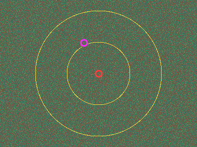

# Day 7 advanced map: generator and viewer

This is a procedural map generator and terminal viewer for a planned "advanced" version of day 7, Buddy's PathFinder. The map is far too big to store or to search naively. It is never stored as data: every tile is computed on demand from one seed.

This folder is a standalone Go module. It is not part of the Astro site build. For how the terrain is built, how the goal works, and how a solver would handle a map this size, see [DESIGN.md](./DESIGN.md).

## The rules the generator guarantees

- `mapgen.Height(seed, x, y)` is a pure function of a `uint64` seed and `int64` coordinates. It never looks at neighbouring tiles, so any tile anywhere in the 2^64 × 2^64 plane can be queried directly. The terrain is equally detailed at `(0, 0)` and at `(2^62, -2^62)`, because large coordinates are never converted to floating point.
- Heights run from **-8 to 8**. A height of **0 or less is passable air**; **1 or more is mountain**. The height only matters for drawing nicer maps.
- **Movement is 4-directional** (north, east, south, west). Two air tiles that touch only at a corner are _not_ connected. There is no diagonal movement and no squeezing between mountains.
- North is `-y`, the top of the screen, as in the original day 7.
- **Every seed is solvable, with exactly one goal.** The start and the goal both lie on a corridor network that is connected by construction, and the goal is the corridor tile with the smallest SHA-256 digest in a ring around the start. See [DESIGN.md](./DESIGN.md#the-goal) for why the goal can't be worked out from the seed.
- The same seed always gives the same map. `TestGolden` pins a checksum, so an accidental change to the generator fails the tests.

```go
import "wcf/day07-map/mapgen"

h := mapgen.Height(seed, x, y)     // -8..8
ok := mapgen.Passable(seed, x, y)  // h <= 0
sx, sy := mapgen.Start(seed)       // the corridor node of cell (0, 0)
ok = mapgen.OnCorridor(seed, x, y) // part of the guaranteed-connected network
ok = mapgen.InRing(seed, x, y)     // 2^18 <= distance from start < 2^19
d, _ := mapgen.ParseDigest(hex)    // the published 64-character goal digest
ok = mapgen.IsGoal(seed, d, x, y)  // true for exactly one tile
g := mapgen.FindGoal(seed, nil)    // organisers: find the goal and its digest
```

## Running it

You need Go 1.23 or newer. From this folder:

```bash
go run . -seed north-pole
```

If Go isn't installed, the official container works too. Run this from the repository root:

```bash
podman run --rm -it -v "$PWD/tools/day07-map":/src -w /src docker.io/library/golang:1.25 go run . -seed north-pole
```

Commands:

| Command                    | What it does                                                                                                                                           |
| -------------------------- | ------------------------------------------------------------------------------------------------------------------------------------------------------ |
| `day07-map [view]`         | Interactive viewer (the default)                                                                                                                       |
| `day07-map dump`           | Prints one frame to stdout. Use `-style shade`, `-style ox` (O/X like day 7) or `-style color`                                                         |
| `day07-map png -o map.png` | Renders a frame to a PNG (`-w`, `-h`, `-scale`)                                                                                                        |
| `day07-map scan`           | Finds the goal and prints its coordinates and the digest to publish. It hashes about 650 million corridor tiles: about 20 s on an idle 12-core machine |
| `day07-map stats`          | Passable fraction, height histogram and time per `Height()` call                                                                                       |
| `go test ./...`            | Determinism, golden checksum, far coordinates, terrain connectivity, corridor connectivity, corridor enumeration and goal uniqueness                   |

Every map command takes `-seed` (a number or any string; strings are hashed), `-x` and `-y` (the centre tile; defaults to the start), and `-zoom` (tiles per pixel, a power of two). They also take `-corridors` to highlight the corridor network, and `-goal X,Y` (or `-goal find`, which runs the full search first) to mark the goal.

### Viewer keys

| Key                                            | Action                                                        |
| ---------------------------------------------- | ------------------------------------------------------------- |
| arrows, `w` `a` `s` `d`, `h` `j` `k` `l`       | Pan 4 pixels                                                  |
| Shift+arrows, `W` `A` `S` `D`, `H` `J` `K` `L` | Pan half a screen                                             |
| `f`                                            | Toggle fast pan, so the normal pan keys move half a screen    |
| `+` / `z`, `-` / `x`                           | Zoom in or out (1 to 2^20 tiles per pixel)                    |
| `m`                                            | Cycle the drawing mode: colour half blocks, ASCII shades, O/X |
| `o` / `0`                                      | Jump to the start                                             |
| `g`                                            | Jump to the goal, once the background search has found it     |
| `c`                                            | Highlight the corridor network                                |
| `?`                                            | Show or hide the help lines                                   |
| `q`                                            | Quit                                                          |

The status line shows the seed, the centre tile with its height, the zoom, the mode, the goal search progress (or the goal once found) and the frame time. The viewer searches for the goal in the background as soon as it starts, using every CPU. Pass `-goal X,Y` to skip that. The default mode draws two square pixels per character cell with `▀` and 24-bit colour, so use a truecolor terminal. Use `m` for plain ASCII. The start is red, the two edges of the goal ring are yellow, the goal tile is magenta and highlighted corridors are cyan.

When zoomed out, each pixel samples up to 4×4 tiles. A pixel counts as mountain when most samples are mountain, so the passable/impassable split stays honest at every zoom.

## Gallery (seed `north-pole`)

Zoom 1:128, centred on the start. Massifs (brown) cover about half the map. Open lowlands (green and blue) are scattered with small mountains.


Zoom 1:32 with `-corridors`. The cyan lines are the guaranteed corridor network, one node per 8192×8192 cell. Without the highlight they look like any other 3–5 tile canyon.


Zoom 1:4: the edge of a massif. Canyons wind through it, a long range with snowy peaks runs along it, and crescents, craters and butte clusters are stamped on the lowland.


Zoom 1:1 inside a massif. The only ways through are canyons, which vary from 2–3 tile slots to broad valleys.


Zoom 1:2 on the lowland: a crescent and scattered small mountains.


A canyon junction from the image above as an O/X capture at zoom 1:2, in the original day 7 style (`dump -style ox -x -1000 -y -550 -zoom 2 -w 100 -h 15`):

```
XXXXXXXXXXXXXXXXXXXXXXXXXXXXXXXXXOOOOOOOOOXXXXXXXXXXXXXXXXXXXXXXXXXXXXXXXXXXXXXXXOOOOOOOOOOOOOOOOOOO
XXXXXXXXXXXXXXXXXXXXXXXXXXXXXXXXXOOOOOOOOXXXXXXXXXXXXXXXXXXXXXXXXXXXXXXXXXXXXXXXXOOOOOOOOOOOOOOOOOOO
XXXXXXXXXXXXXXXXXXXXXXXXXXXXXXXXXOOOOOOOOXXXXXXXXXXXXXXXXXXXXXXXXXXXXXXXXXXXXXXXOOOOOOOOOOOOOOOOOOOO
XXXXXXXXXXXXXXXXXXXXXXXXXXXXXXXXXOOOOOOOOXXXXXXXXXXXXXXXXXXXXXXXXXXXXXXXXXXXXXXOOOOOOOOOOOOOOOOOOOOO
XXXXXXXXXXXXXXXXXXXXXXXXXXXXXXXXXOOOOOOOOXXXXXXXXXXXXXXXXXXXXXXXXXXXXXXXXXXXXXXOOOOOOOOOOOOOOOOOOOOO
XXXXXXXXXXXXXXXXXXXXXXXXXXXXXXXXXOOOOOOOOXXXXXXXXXXXXXXXXXXXXXXXXXXXXXXXXXXXXXOOOOOOOOOOOOOOOOOOOOOO
XXXXXXXXXXXXXXXXXXXXXXXXXXXXXXXXXOOOOOOOOXXXXXXXXXXXOOOOOOOOOXXXXXXXXXXXXXXXXOOOOOOOOOOOOOOOOOOOOOOO
XXXXXXXXXXXXXXXXXXXXXXXXXXXXXXXXXOOOOOOOXXXXXXXXOOOOOOOOOOOOOOOOOXXXXXXXXXXXXOOOOOOOOOOOOOOOOOOOOOOO
XXXXXXXXXXXXXXXXXXXXXXXXXXXXXXXXOOOOOOOOXXXXXOOOOOOOOOOOOOOOOOOOOOOXXXXXXXOOOOOOOOOOOOOOOOOOOOOOOOOO
XXXXXXXXXXXXXXXXXXXXXXXXXXXXXXXXOOOOOOOXXXOOOOOOOOOOOOOOOOOOOOOOOOOOOOXXXOOOOOOOOOOOOOOOXXXXXXOOOOOO
XXXXXXXXXXXXXXXXXXXXXXXXXXXXXXXOOOOOOOOXOOOOOOOOOOOOOOOOOOOOOOOOOOOOOOOOOOOOOOOOOOOOOOOXXXXXXXXXOOOO
XXXXXXXXXXXXXXXXXXXXXXXXXXXXXXXOOOOOOOOOOOOOOOOXXXXXXXXXOOOOOOOOOOOOOOOOOOOOOOOOOOOOOXXXXXXXXXXXXOOO
XXXXXXXXXXXXXXXXXXXXXXXXXXXXXXXOOOOOOOOOOOOXXXXXXXXXXXXXXXOOOOOOOOOOOOOOOOOOOOOOOOOOOXXXXXXXXXXXXOOO
XXXXXXXXXXXXXXXXXXXXXXXXXXXXXXOOOOOOOOOOOXXXXXXXXXXXXXXXXXXXOOOOOOOOOOOOOOOOOOOOOOOOXXXXXXXXXXXXXXOO
XXXXXXXXXXXXXXXXXXXXXXXXXXXXXXOOOOOOOOOXXXXXXXXXXXXXXXXXXXXXXOOOOOOOOOOOOOOOOOOOOOOXXXXXXXXXXXXXXXXO
```

The whole goal ring at zoom 1:4096: the start (red), the ring between 262,144 and 524,288 tiles out (yellow), and the goal (magenta). At this zoom the terrain is just noise:



`scan` finds the goal for `north-pole` at (-117825, -254570), 284,476 tiles from the start, with digest `0000000d977a6440d8d0288e30f21e9bd6c2799dc7b8030f2a68322d0837babb`. Here it is at zoom 1:8 with corridors highlighted. It lies on a north–south corridor through open lowland:


